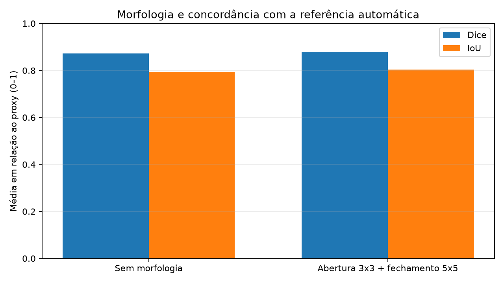
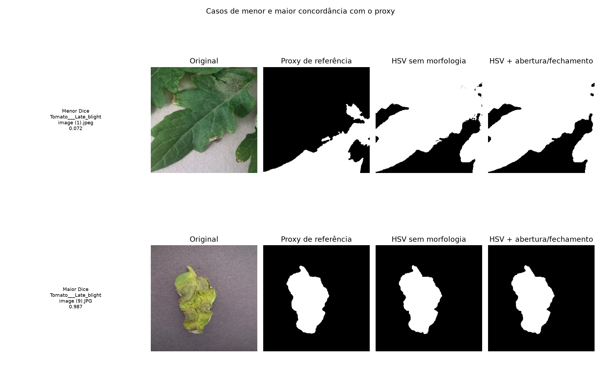

# Relatório parcial M2 — Processamento de imagens de folhas de tomate

**Grupo 14 — revisão em 27/10/2026**

**Integrantes:** João Vitor Schwambach Brasil e Luiz Gustavo Machado Muller.

## 1. Problema e objetivos atuais

O projeto investiga quatro rótulos de imagens de tomate: saudável, requeima
(`Tomato___Late_blight`), septoriose (`Tomato___Septoria_leaf_spot`) e
`Tomato___Tomato_Yellow_Leaf_Curl_Virus`. O objetivo final segue sendo testar se
descritores clássicos de cor e textura podem apoiar a classificação. A M2 entrega
um fluxo parcial executável: leitura → máscara HSV → morfologia/componentes →
descritores → métricas/arquivos verificáveis.

O classificador, uma partição de dados livre de imagens derivadas e a avaliação
com máscaras de referência manuais ainda não foram implementados. O resultado não
é diagnóstico agronômico.

### Escopo exigido pela M2: classificação e máscaras manuais

O enunciado da M2 **não exige um classificador final**: permite que a inferência
ou o classificador completo permaneçam em desenvolvimento, desde que haja plano
concreto para a M3. Também **não exige especificamente máscaras anotadas à mão**:
solicita uma forma adequada de verificar resultados, que pode ser referência
manual, rótulos, contagens conhecidas ou outro procedimento pertinente. Quando a
referência ainda está incompleta, a avaliação deve ser declarada preliminar e sua
conclusão planejada. Nesta entrega, usamos um proxy automático de máscara e
declaramos essa limitação; máscaras manuais e o classificador ficam como tarefas
planejadas, não como requisito já cumprido.

## 2. Evolução desde a M1 e resposta ao feedback

| Feedback/pendência da M1 | Ação e evidência atual |
|---|---|
| Reproduzir a segmentação em mais imagens e medir a saída | `src/tomato_pdi/` processa 12 imagens por classe (48 no total) e grava Dice/IoU em `results/m2/segmentacao_metricas.csv`. O alvo é um proxy automático; não é anotação manual. |
| Avaliar morfologia | Abertura elíptica 3×3 seguida de fechamento 5×5 é comparada com a mesma máscara HSV sem essas operações. Métricas e pergunta estão nas seções 4–5. |
| Extrair textura, principalmente para estudar requeima e septoriose | `descritores.csv` inclui contraste, homogeneidade e energia GLCM, além de cor e geometria. A capacidade de discriminar classes ainda não foi medida por classificador. |
| Evitar partições contaminadas por variantes/aumentos | Não existe partição treino/teste na M2. A composição/origem de arquivos homônimos deve ser auditada antes da divisão da M3; não se afirma que os arquivos sejam originais independentes. |
| Limitação de PlantVillage para fotos de campo | Mantida. A inspeção local encontrou variação de fundo e exemplos com folhas sobrepostas, o que também desafia a hipótese de uma única folha central. A equipe deve confirmar a origem exata dos dados e não inferir generalização a campo. |
| Caminhos inconsistentes e dificuldade de reprodução | Há CLI com caminhos configuráveis, ambiente descrito no README e saída `results/m2/`. |

A proposta M1 foi mantida quanto às quatro classes e à investigação de cor/textura.
O escopo efetivamente concluído na M2 é segmentação e descrição; não se afirma
que o pipeline de classificação esteja pronto.

## 3. Dados e protocolo

O documento da equipe identifica os dados locais como PlantVillage, versão
`without_augmentation`, obtidos no registro Mendeley Data indicado em
[`../images/README.md`](../images/README.md), com licença declarada CC0. Essa
informação é uma declaração anterior da equipe e deve ser reconfirmada contra a
versão realmente utilizada antes da publicação. A amostra de imagens inspecionada
tem 256×256 pixels e mostra fundos variados; algumas imagens contêm mais de uma
folha. O relatório não presume que todo o conjunto seja uma única folha em fundo
homogêneo.

| Classe | Imagens encontradas localmente | Imagens do experimento |
|---|---:|---:|
| Saudável | 1.591 | 12 |
| Requeima | 1.909 | 12 |
| Septoriose | 1.771 | 12 |
| Yellow Leaf Curl Virus | 5.357 | 12 |
| **Total** | **10.628** | **48** |

O script ordena nomes de arquivo numericamente e seleciona as primeiras 12 imagens
de cada pasta. A amostra é determinística e balanceada, mas não aleatória nem
representativa; nomes diferentes com extensões distintas podem corresponder a
conteúdos distintos. Não se usa treinamento. As mesmas 48 imagens e os mesmos
parâmetros de referência são usados nas duas configurações.

**Referência quantitativa provisória:** `proxy_reference_from_corners` converte a
imagem a Lab, mede a distância Euclidiana de cada pixel às medianas de quatro
pequenas regiões nos cantos e marca como provável objeto os pixels a mais de 18
níveis de distância. O proxy recebe fechamento morfológico e seleção da maior
componente. Esta é uma heurística de cor de fundo, não uma máscara revisada por
pessoa; pode falhar se os cantos incluírem folhas/sombras, se o fundo variar ou se
houver múltiplos objetos. Consequentemente, Dice e IoU abaixo quantificam apenas
concordância com esse proxy. Não são uma estimativa de desempenho contra a verdade
de-terreno.

## 4. Pipeline implementado

| Etapa | Entrada / saída | Técnica e parâmetros | Estado |
|---|---|---|---|
| Seleção/leitura | Uma imagem BGR por arquivo → matriz uint8 | Quatro diretórios de classe; ordenação numérica; leitura OpenCV | Implementado |
| Segmentação | Imagem → máscara binária | OpenCV HSV: H 20–100, S ≥ 35, V ≥ 25; maior componente conectado | Implementado |
| Morfologia | Máscara binária → máscara limpa | Abertura elíptica 3×3 e fechamento elíptico 5×5; maior componente após operações | Implementado e comparado |
| Geometria | Máscara → medidas | Área em pixels; área percentual; perímetro em pixels; circularidade `4πA/P²` | Implementado |
| Cor | Pixels incluídos na máscara → médias | Médias H/S/V OpenCV e L/a/b OpenCV; unidades/ranges nos cabeçalhos do CSV | Implementado |
| Textura | Pares vizinhos dentro da máscara → GLCM | 16 níveis de cinza; offsets (0,1), (1,0), (1,1); matriz simétrica normalizada; contraste, homogeneidade e energia | Implementado |
| Classificação | Vetor de características → classe | Sem classificador nesta entrega | Pendente para M3 |

Os campos dos CSVs indicam a classe pelo nome da pasta, não uma classe prevista.
Não há treino, validação ou teste nesta execução.

## 5. Experimento controlado

**Pergunta:** a abertura 3×3 seguida de fechamento 5×5 aumenta a concordância de
uma máscara HSV com o proxy de fundo?

**O que mudou:** somente as operações de abertura/fechamento.
**O que permaneceu constante:** as mesmas 48 imagens, limiares HSV, seleção do
maior componente, algoritmo do proxy e métricas.

**Execução reproduzível:**

```bash
python -m tomato_pdi \
  --dataset-dir images/tomato_subset \
  --output-dir results/m2 \
  --samples-per-class 12
```

| Configuração | Dice médio vs. proxy | IoU médio vs. proxy |
|---|---:|---:|
| Limiar HSV e maior componente, sem morfologia | 0,8723 | 0,7930 |
| Abertura 3×3 + fechamento 5×5 | 0,8786 | 0,8030 |
| Diferença observada | +0,0063 | +0,0100 |

Os resultados exatos por imagem estão em
[`../results/m2/segmentacao_metricas.csv`](../results/m2/segmentacao_metricas.csv);
as médias também estão em [`../results/m2/resumo.json`](../results/m2/resumo.json).
A mudança média é pequena. Sem uma referência independente/manual, não permite
concluir que a máscara da folha ficou correta.



**Figura 1 —** Média de concordância com o proxy nos mesmos 48 arquivos. A pequena
diferença é visível; o eixo não representa acurácia contra anotação humana.



**Figura 2 —** Casos de menor e maior Dice no lote. No caso de menor concordância,
`Tomato___Late_blight/image (1).jpeg`, os cantos não representam apenas o fundo e
o proxy se torna inadequado; a máscara HSV também perde regiões verdes escuras. No
caso de maior concordância, `Tomato___Late_blight/image (9).JPG`, os dois métodos
produzem regiões semelhantes ao proxy. Esses casos mostram sucesso/limitação do
procedimento, não validação visual de contorno real.

## 6. Saídas verificáveis

- [`../results/m2/segmentacao_metricas.csv`](../results/m2/segmentacao_metricas.csv):
  uma linha por imagem, parâmetros e métricas comparadas.
- [`../results/m2/descritores.csv`](../results/m2/descritores.csv): atributos
  geométricos, cor e textura, com unidades/ranges no nome das colunas.
- [`../results/m2/resumo.json`](../results/m2/resumo.json): amostra, referência
  provisória e resultados agregados.
- [`../results/m2/comparacao_morfologia.png`](../results/m2/comparacao_morfologia.png)
  e [`../results/m2/mascaras_exemplo.png`](../results/m2/mascaras_exemplo.png):
  figuras regeneradas pelo mesmo comando.

## 7. Falhas, limitações e riscos

1. **Referência circular/proxy:** o proxy foi criado automaticamente a partir da
   própria imagem e recebe pós-processamento; não substitui máscaras anotadas e
   revisadas. A métrica pode favorecer uma configuração por semelhança com a
   heurística, não com a folha real.
2. **Cantos com objeto ou iluminação variável:** a estimativa de fundo falha em
   cenas com várias folhas, sombras ou fundo não uniforme. O mínimo Dice do lote
   foi 0,0722 nessa referência inadequada.
3. **HSV fixo:** partes verde-escuras, amareladas ou lesionadas podem ficar fora da
   faixa, enquanto objetos verdes do fundo podem entrar. Ajuste de parâmetros pode
   variar com a iluminação.
4. **Maior componente:** remove folhas/partes desconectadas mesmo quando pertencem
   à cena de interesse.
5. **Amostragem:** primeiras 12 imagens por ordem numérica não constituem amostra
   aleatória. Não se avaliou a integridade de duplicatas nem a origem de variantes.
6. **Escopo:** descritores foram calculados, mas sua capacidade discriminativa não
   foi testada. Nenhuma acurácia de doença é reportada.
7. **Generalização:** os resultados não demonstram desempenho em fotos de campo.

## 8. Plano de conclusão para M3

| Tarefa | Responsável | Evidência esperada |
|---|---|---|
| Confirmar fonte, licença, versão, restrições de redistribuição e estrutura do dataset; revisar arquivos já rastreados no histórico | Luiz Gustavo Machado Muller (registro/documentação); João Vitor Schwambach Brasil (revisão técnica) | Fonte/versão verificadas; instrução de obtenção reproduzível; política de dados atendida |
| Selecionar imagens diversas e auditar duplicatas/variantes por conteúdo e origem | João Vitor Schwambach Brasil (auditoria técnica); Luiz Gustavo Machado Muller (inventário/protocolo) | Inventário de IDs e divisão sem vazamento entre conjuntos |
| Anotar manualmente máscaras de uma amostra estratificada e fazer revisão cruzada | João Vitor Schwambach Brasil e Luiz Gustavo Machado Muller | Máscaras, protocolo, avaliadores e limites documentados |
| Comparar HSV e alternativa (p.ex. Otsu/GrabCut) nas mesmas imagens com Dice/IoU contra referência manual | João Vitor Schwambach Brasil (implementação); Luiz Gustavo Machado Muller (revisão dos resultados) | CSV, visualizações de sucesso/falha e análise por classe |
| Avaliar GLCM e cor para requeima vs. septoriose; escolher um classificador clássico | João Vitor Schwambach Brasil (pipeline/classificador); Luiz Gustavo Machado Muller (protocolo e revisão) | Experimento de treino/validação/teste agrupado por imagem de origem, métricas e matriz de confusão |
| Reproduzir a execução do zero, revisar documentação/contribuições e registrar versão | Luiz Gustavo Machado Muller (documentação); João Vitor Schwambach Brasil (reprodução técnica); revisão por ambos | Comandos executáveis, README atualizado, responsabilidades, commit/tag da entrega |
| Gravar vídeo de aproximadamente 10 minutos, não listado, com participação identificável de todos | Todos | Link acessível no README após conferência |

Esta divisão prevista para a M3 segue os papéis informados para a M2: João assume
implementação e experimentação; Luiz assume documentação, organização e revisão;
anotação e vídeo são conjuntos. Ambos devem confirmar a distribuição e definir
datas no início da etapa, pois o calendário acadêmico ainda não foi informado.
O vídeo M2 não foi possível de realizar dentro do prazo e será gravado
posteriormente; o link será adicionado ao README após a publicação como não listado.

## 9. Contribuições, referências e IA

**Contribuições registradas pela equipe para esta revisão:** João Vitor
Schwambach Brasil — proposta/resposta ao feedback M1 e implementação/execução do
pipeline M2. Luiz Gustavo Machado Muller — proposta/resposta ao feedback M1,
relatório, README, organização e revisão/validação. Ambos — revisão conjunta do
escopo e preparação do vídeo, ainda pendente de gravação. Os integrantes devem
confirmar que esta atribuição corresponde ao trabalho efetivamente realizado. O
histórico Git deve ser complementado com registros de dados, experimentos,
documentação, revisão e apresentação; contagem de commits não mede isoladamente a
participação.

**Referências:** Hughes & Salathé (2015), Mohanty, Hughes & Salathé (2016) e
Gonzalez & Woods (2018), listadas em
[`proposta.md`](proposta.md#11-referências). Origem e licença declaradas do dado
estão em [`../images/README.md`](../images/README.md) e precisam de revisão final.

**IA generativa:** desenvolvimento assistido por ferramenta integrada ao Copilot
SDK no VS Code, registrada em [`../AI_USAGE.md`](../AI_USAGE.md). A equipe precisa
revisar, entender e confirmar o código e o relatório antes da entrega.
